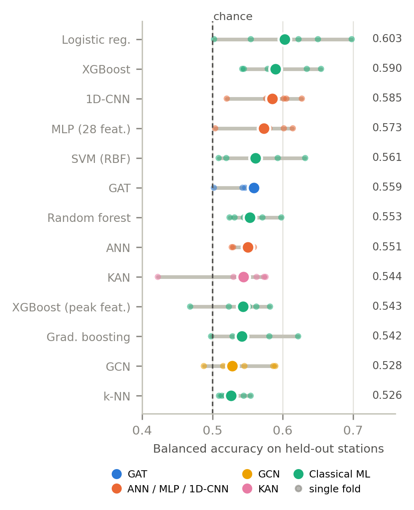

# Seismic Wildlife Classification: Graph, Neural and Classical Models

A benchmark of thirteen classifiers that separate **Giraffidae from Elephantidae** using seismic
ground vibrations from the public SeisSavanna recordings (Mpala Research Centre, Kenya). Every model
is tested on recording stations it never saw during training. The repository holds the benchmark
code, all stored results, the figure scripts and the manuscript.

**Main finding:** on unseen stations every model was weak (balanced accuracy 0.526 to 0.603). The
choice of held-out stations changed scores more than the choice of model. XGBoost scored 0.888 in
the earlier random-split experiments with test-set selection, but only 0.590 here.



## Contents

- [Project status](#project-status)
- [Results](#results)
- [Evaluation protocol](#evaluation-protocol)
- [Models](#models)
- [Dataset](#dataset)
- [Repository layout](#repository-layout)
- [Reproducing the work](#reproducing-the-work)
- [Earlier experiments](#earlier-experiments)
- [Limitations](#limitations)
- [Citation and licence](#citation-and-licence)

## Project status

The manuscript (`main.tex`, `main.pdf`) is an unsubmitted draft for *Engineering Applications of
Artificial Intelligence*. Still open:

- **Random-split control.** The code includes this experiment (phase `4_control`), but its results
  are not in `results/dgx_rigorous/`. Two `% TODO` notes in `main.tex` mark where they go.
- **Author details.** Names, affiliation and email in `main.tex` are placeholders.
- **On-device tests.** No model has run on an ESP32-S3, so device latency and energy are unmeasured.

## Results

Scores below are for the 54,901-window peak cohort. BA is the balanced accuracy of the pooled
out-of-fold predictions, averaged over seeds. Fold SD is the variation between the five held-out
station groups. Giraffidae is the positive class.

| Model | BA | Fold SD | MCC | AUROC | Giraffidae recall |
|---|---:|---:|---:|---:|---:|
| Logistic regression | 0.603 | 0.078 | 0.103 | 0.611 | 0.571 |
| XGBoost | 0.590 | 0.051 | 0.114 | 0.621 | 0.346 |
| 1D-CNN | 0.585 | 0.041 | 0.100 | 0.603 | 0.403 |
| Feature MLP | 0.573 | 0.043 | 0.082 | 0.594 | 0.405 |
| SVM (RBF) | 0.561 | 0.051 | 0.070 | 0.580 | 0.352 |
| GAT | 0.559 | 0.023 | 0.068 | 0.577 | 0.356 |
| Random forest | 0.553 | 0.030 | 0.083 | 0.590 | 0.208 |
| ANN | 0.551 | 0.015 | 0.066 | 0.545 | 0.267 |
| KAN | 0.544 | 0.064 | 0.049 | 0.536 | 0.336 |
| XGBoost (peak features) | 0.543 | 0.044 | 0.049 | 0.572 | 0.332 |
| Gradient boosting | 0.542 | 0.048 | 0.043 | 0.556 | 0.400 |
| GCN | 0.528 | 0.044 | 0.028 | 0.563 | 0.506 |
| k-NN | 0.526 | 0.020 | 0.088 | 0.591 | 0.070 |

Differences among the top models are smaller than the differences between stations, so this table
does not establish a single best model.

Other findings:

- **Station shift.** Validation and test scores were uncorrelated (r = -0.02 over 65 model-fold
  pairs).
- **Graph structure.** Random edges (0.564) matched the structured peak graph (0.559). Removing all
  edges gave 0.523. These ablations used one seed, and the GAT's seed SD is 0.019.
- **Attention.** Deleting high-attention nodes flipped more predictions than deleting random nodes
  (16.2% against 6.2% at 10% deletion), but balanced accuracy did not fall.
- **Peak detector.** XGBoost on pooled peak features stayed at 0.526 to 0.541 across the valid
  detector settings. Higher prominence removed more Elephantidae than Giraffidae windows.
- **Accuracy misleads.** k-NN had the highest accuracy (0.924) and the lowest balanced accuracy.
- **Cohort restriction.** XGBoost on all 66,814 windows scored 0.583, against 0.590 on the peak
  cohort. The ANN scored 0.528 against 0.551.

### Edge cost

These are fold-0 models, measured against a 512 KB flash budget. Times are single-thread host-CPU
medians for preprocessing plus inference. They rank the models but are not device latencies.

| Model | Parameters | FP32 size | INT8 or C size | Host time | Fits flash |
|---|---:|---:|---:|---:|---|
| GAT | 26,882 | 112.1 KB | 89.1 KB | 2.96 ms | Yes, with a hand-written sparse kernel |
| ANN | 558,466 | 2,189.7 KB | 558.9 KB | 0.25 ms | No |
| Feature MLP | 4,194 | 22.2 KB | 12.8 KB | 0.66 ms | Yes |
| 1D-CNN | 94,210 | 377.0 KB | 376.1 KB | 0.76 ms | Yes |
| KAN | 13,120 | 58.8 KB | 58.8 KB | 1.57 ms | Yes, with spline look-up tables |
| GCN | 3,746 | 36.6 KB | 28.6 KB | 0.83 ms | Yes |
| XGBoost | not applicable | 339.3 KB (serialised) | 26.5 KB (C arrays, computed) | 0.95 ms | As C arrays only |
| Logistic regression | 29 | 0.9 KB (serialised) | not applicable | not timed | Yes |

The SVM (7.3 MB), k-NN (5.1 MB) and random forest (31.3 MB) do not fit.

## Evaluation protocol

All primary models share these rules:

1. **One cohort:** the 54,901 binary windows with at least two detected peaks (51,410 Elephantidae,
   3,491 Giraffidae; 14.7:1).
2. **Station-held-out testing:** five-fold `StratifiedGroupKFold` with the station as the group. The
   code asserts that no test station appears in training or validation.
3. **Validation-only selection:** a station-grouped inner split drives every hyperparameter choice
   and all early stopping. Each test fold is scored once, at a fixed threshold of 0.5.
4. **Repeats:** seeds 0, 1 and 2. Logistic regression, SVM and k-NN are deterministic and run once.
5. **Imbalance handling:** class-weighted loss for neural models, and balanced weights for classical
   estimators except k-NN, which is unweighted.

| Fold | Test stations | Test windows (Giraffidae) | Validation stations | Validation windows | Training windows |
|---:|---|---:|---|---:|---:|
| 0 | 5, 12 | 11,197 (688) | 4, 11 | 15,368 | 28,336 |
| 1 | 10, 18 | 8,622 (875) | 4, 11 | 15,368 | 30,911 |
| 2 | 4, 19 | 14,284 (896) | 5, 16 | 10,459 | 30,158 |
| 3 | 3 | 9,105 (506) | 10, 11 | 6,867 | 38,929 |
| 4 | 11, 16, 17 | 11,693 (526) | 4, 5 | 19,242 | 23,966 |

McNemar tests were computed but are not used for ranking. Windows are not independent, and with
54,901 of them, 77 of 78 pairs came out "significant". Differences are judged against fold and seed
variation instead.

## Models

| Model | Input | Architecture | Search grid |
|---|---|---|---|
| GAT | Peak graph: 8-D nodes, temporal chain plus 5-NN edges | 3 GATConv layers, mean and max pooling, MLP head | Width {32, 64}, heads {2, 4}, learning rate {1e-3, 5e-4}, node features {raw, standardised} |
| GCN | 64-segment chain: raw values or 21 statistics | 2 graph-convolution layers, mean pooling | Encoding, learning rate |
| KAN | 24 pooled peak statistics | KANLinear 24-32-16-2 or 24-64-32-2 | Width, learning rate |
| ANN | Standardised raw X or XYZ waveform | Dense network with batch norm and dropout | Input, width {256, 512}, learning rate |
| Feature MLP | 28 engineered features | Same as the ANN | Width {64, 128}, learning rate |
| 1D-CNN | Standardised 3-component waveform | 3 convolution blocks, mean and max pooling | Channels {16, 32}, learning rate |
| Classical | 28 engineered features | Logistic regression, SVM, k-NN, random forest, gradient boosting, XGBoost | 1 to 6 settings each |

Two XGBoost variants test specific questions. `XGBoost (pooled peaks)` uses the 24 peak statistics
as a graph-free baseline. `XGBoost [all windows]` checks the peak-cohort restriction.

The GAT also runs with temporal-only, k-NN-only, random and no edges, and with the other node
scaling. An attention-deletion test and a peak-detector sweep complete the extras.

## Dataset

**SeisSavanna** (Szenicer et al., 2022, [doi:10.1002/rse2.242](https://doi.org/10.1002/rse2.242)).
This project uses `dset_allspec_150_chunks_clean.nc`. The file is about 29.5 GB and is not in this
repository, so obtain it from the dataset authors.

| Variable | Shape | Meaning |
|---|---|---|
| `chunk` | (70637, 3, 2048) | Three-component waveform, 10.24 s at 200 Hz |
| `class` | (70637,) | Integer label, named by the file's `class_dict` group |
| `distance` | (70637,) | Sighting distance, 11.4 to 149.8 m |
| `seis` | (70637,) | Station identifier (10 stations) |
| `image` | (70637, 128, 128, 3) | Camera-trap image for each window, not used by the models |

| ID | Family | Windows | | ID | Family | Windows |
|---:|---|---:|---|---:|---|---:|
| 0 | Hominidae | 2,073 | | 6 | **Giraffidae** | **4,321** |
| 1 | **Elephantidae** | **62,493** | | 7 | Hyaenidae | 42 |
| 2 | Suidae | 164 | | 8 | Leporidae | 10 |
| 3 | Felidae | 2 | | 9 | Equidae | 488 |
| 4 | Numididae | 271 | | 11 | Hippopotamidae | 4 |
| 5 | Bovidae | 769 | | | | |

Class 10 (Mustelidae) has no windows.

> **Label warning:** the earlier notebooks use an old label map that calls class 6 "Wildebeest",
> class 5 "Zebra" and class 9 "Hyena". This project uses the names stored in the data file, so class
> 6 is Giraffidae. The mapping is in `PROJECT/class_verification/class_dict_official.json`, and
> `build_report.py` in the same folder checks it against the camera-trap frames.

## Repository layout

```text
.
|-- README.md
|-- requirements.txt
|-- main.tex, main.pdf          Manuscript source and compiled draft
|-- cas-refs.bib                Bibliography
|-- highlights.txt              Journal highlights
|-- figs/                       The 11 figures used by the manuscript
|-- dgx_run/
|   |-- rigorous_benchmark.py   The whole benchmark: prepare, train, aggregate
|   |-- run_dgx.sh              Background launcher with Python auto-detection
|   `-- README.md               Detailed run guide and options
|-- results/dgx_rigorous/       Stored output of the benchmark run
|   |-- config.json             Grids, budgets and seeds
|   |-- splits.json             Window indices of every fold
|   |-- paper_results.json      Environment, cohort and all tables in one file
|   |-- tables/                 Summary, McNemar, grid, attention, detector, edge CSVs
|   |-- runs/                   One JSON per model, fold and seed, with training history
|   |-- preds/                  Out-of-fold predictions (.npz)
|   |-- grid/                   Validation score of every searched configuration
|   |-- models/                 Selected configurations (JSON only, no weights)
|   `-- logs/                   Worker logs
|-- figure_sources/
|   |-- make_rigorous_figures.py  Draws figs/r_*.png from the stored results
|   |-- make_paper_figures.py     Shared style and figs/signal_and_peaks.png
|   |-- paper_data.py             Values transcribed from the earlier notebooks
|   `-- rigorous_*.csv            Summary tables written by the figure script
|-- PROJECT/class_verification/
|   |-- build_report.py         Builds the per-class label evidence report
|   `-- class_dict_official.json  Official class mapping
`-- *.ipynb                     Earlier experiments (see below)
```

Not in this repository:

- The dataset, because of its size.
- Trained weights.
- Files in `PROJECT/class_verification/out/`, because the camera-trap frames show identifiable
  people. `build_report.py` regenerates them once you set `NC_PATH` at the top of that script to
  your dataset path.

## Reproducing the work

### Redraw the figures (no dataset or GPU needed)

```bash
git clone https://github.com/aaron43210/SIGNAL_PROCESSING_AI_ML.git
cd SIGNAL_PROCESSING_AI_ML
python -m venv .venv
source .venv/bin/activate
pip install numpy pandas matplotlib
python figure_sources/make_rigorous_figures.py
```

This writes `figs/r_*.png` and `figure_sources/rigorous_*.csv`. A different matplotlib version can
change the image files slightly, but not the data they show.

`figs/signal_and_peaks.png` is the one figure that needs the dataset. Place the `.nc` file in the
repository root, install `netCDF4` and `scipy`, then run:

```bash
cd figure_sources
python -c "import make_paper_figures as m; m.fig_signal_peaks()"
```

Do not run `make_paper_figures.py` as a script unless you want the older figures, because it writes
them into `figs/`.

### Build the manuscript

```bash
tectonic -X compile main.tex
```

The document uses Elsevier's `cas-dc` class. Tectonic fetches it automatically.

### Re-run the benchmark (needs the dataset and GPUs)

Place `dset_allspec_150_chunks_clean.nc` in the repository root, or pass `--data PATH`, then run:

```bash
pip install -r requirements.txt
bash dgx_run/run_dgx.sh --check   # shows the Python and dataset it found; starts nothing
bash dgx_run/run_dgx.sh --smoke   # short end-to-end test on 3,000 windows
bash dgx_run/run_dgx.sh           # full run in the background; safe to log out
```

- Every free GPU is used, and a stopped run resumes where it left off.
- Output goes to `dgx_run/results_rigorous/` and `dgx_run/results_rigorous.zip`.
- To redraw figures from a new run, copy that output into `results/dgx_rigorous/`.
- Options and SLURM use are in [dgx_run/README.md](dgx_run/README.md).

The stored run used Python 3.9.16, PyTorch 2.8.0, PyTorch Geometric 2.6.1, scikit-learn 1.3.2,
XGBoost 2.1.4, SciPy 1.11.4 and NumPy 1.26.4 on NVIDIA A100 GPUs. The main benchmark (423 jobs) took
about 50 minutes.

## Earlier experiments

These notebooks are the first, exploratory experiments. They are kept because
`figure_sources/paper_data.py` takes values from their saved outputs.

| Notebook | Experiment |
|---|---|
| `class1_and_class6_weighted.ipynb` | Binary peak-graph GAT with weighted loss and a 16-configuration grid |
| `ann_classifier_weighted.ipynb` | Binary ANN on the standardised X component |
| `ann_classifier_unweighted.ipynb` | The same ANN without input standardisation |
| `ml_classifier.ipynb` | Six classical estimators on 28 engineered features |
| `gcn(final).ipynb` | Five-class GCN on a balanced 2,250-window cohort |
| `kan.ipynb` | KAN on 11 classes, unweighted |
| `kan_weighted.ipynb` | KAN on 8 classes with undersampling and capped class weights |

> **Do not use these scores as performance estimates.** The binary notebooks split windows at random
> and selected models on the test partition, so recordings of one animal passage can reach both
> sides of the split. Their paths are also specific to the machine they ran on. Use
> `results/dgx_rigorous/` for current results.

## Limitations

- No model was run on a microcontroller. INT8 sizes come from dynamic quantisation of linear layers
  only, and XGBoost's C-array size is computed from node counts, not compiled.
- Ten stations give noisy fold estimates.
- The data file has no sighting or time identifiers, so time-ordered and sighting-grouped splits are
  not possible. Windows from one passage can still fall on both sides of the inner
  training/validation split, but test stations stay fully separate.
- Thresholds are fixed at 0.5 and not calibrated per station.
- Only the Elephantidae versus Giraffidae task was benchmarked.

## Citation and licence

The manuscript has not been published, so there is no paper to cite for this work yet. If you use
the data, cite:

> Szenicer, A., Reinwald, M., Moseley, B., Nissen-Meyer, T., Mutinda Muteti, Z., Oduor, S.,
> McDermott-Roberts, A., Baydin, A. G., Mortimer, B. (2022). Seismic savanna: machine learning for
> classifying wildlife and behaviours using ground-based vibration field recordings. *Remote Sensing
> in Ecology and Conservation*, 8(2), 236-250.

No licence has been chosen for this repository, so no reuse rights are granted yet. The dataset is
subject to its authors' terms.
